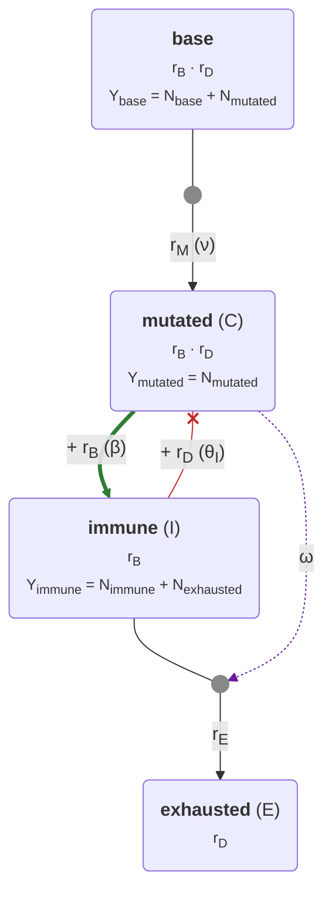

# Plan: añadir fibroblastos (F_N, F_T) al Gillespie

> Estado: **propuesta**. Prototipo en `docs/fibroblastos_prototype.patch`.
> Se aplica sobre `main` con `git apply`; después hay que regenerar el diagrama
> (`python -m scripts.model_diagram --write`) y quedan 103/103 tests en verde.
> Con los fibroblastos apagados, una simulación con semilla da exactamente la
> misma trayectoria que el código actual (`test_seeded_trajectory_is_unchanged`).

La notación sigue [`NOTATION.md`](NOTATION.md). Hay dos capas:

- **Campo medio**: la que usan el informe (`main.pdf`, ec. 4), `scaling_calculator.py` y `notebooks/omega_convergence.py`. Poblaciones C, I, E.
- **Gillespie**: la que usan `README.md` y el póster. Tasas `r_B, r_D, r_M, r_E`, cuentas `N_<tipo>`. El crowding es `g(Y, K_X) = 1 − Y/K_X` en las dos capas.

Los fibroblastos se añaden como dos poblaciones nuevas, F_N y F_T, en las dos capas.

## 0. Resumen

No basta con «una subclase nueva en `clone.py`». Hacen falta:

1. **Dos tipos nuevos**, no uno: `fibroblast` (F_N) y `caf` (F_T). Siguen el mismo patrón que `immune` → `exhausted`.
2. **Interacciones nuevas en dos subclases que ya existen**:
   - `MutatedClone`: los CAF aumentan `r_B(mutated)`.
   - `ImmuneClone`: los CAF aumentan `r_E(immune)`.
3. **Quitar los tipos fijados a mano** fuera de `clone.py`. Si no se quitan, la conversión F_N → F_T acabaría en `exhausted`:
   - `TumorSimulation._induce_exhaustion` tiene fijado el destino `cell_parameters["exhausted"]`.
   - `CrowdingStrategy.crowding` compara con `"exhausted"`.

   Los ids ya no están fijados a mano: `CellTypeConfig.default_id` es la única fuente. `TumorSimulation.__init__` crea un clon raíz por tipo de `cell_parameters` y `csv_output.clone_id_to_str` saca los nombres de `default_id`.
4. **Parámetros nuevos** en `SimulationConfig`, con su escalado por `OMEGA`.

---

## 1. Notación

### 1.1 Poblaciones

| Tipo (código) | Campo medio | Gillespie | Del cuaderno |
|---|---|---|---|
| `base` | (no aparece en el modelo de 3 poblaciones) | `N_base` | — |
| `mutated` | C | `N_mutated` | C |
| `immune` | I | `N_immune` | T_A |
| `exhausted` | E | `N_exhausted` | E |
| `fibroblast` | **F_N** | `N_fibroblast` | f_N |
| `caf` | **F_T** | `N_caf` | f_T |

El crowding se escribe `g(Y, K_X) = 1 − Y/K_X`. `Y` es la población que compite con el tipo X: la suma que devuelve `crowding_numerator()`. `K_X` es su capacidad de carga. En campo medio va sin escalar (K_C, K_I, K_F). En Gillespie va escalada (`actual_K`): × `OMEGA` e inflada por `AdaptedCrowding`. El código la limita a `max(0, g)`. No se usa el `C(t)` antiguo del README. La población tumoral se escribe C en campo medio y `N_mutated` en Gillespie.

### 1.2 Parámetros

Los parámetros nuevos siguen el patrón de los existentes. Las tasas propias llevan el subíndice del tipo (λ_C, μ_E → λ_F, μ_F). La capacidad es K_tipo (K_C, K_I → K_F). Las interacciones son letras griegas: sin subíndice si las causa C (β, ω) y con subíndice si las causa otro tipo (θ_I → ω_F, α_F).

| Cuaderno | Dimensional | Adimensional (ec. 4: tasas / λ_C) | Gillespie (código) | Escalado |
|---|---|---|---|---|
| r_F | λ_F | ρ_F = λ_F / λ_C | `cell_parameters["fibroblast"].lambda0` | — |
| K | K_F | k = K_C / K_F | `cell_parameters["fibroblast"].K` | fracción de `OMEGA`, × `OMEGA` |
| d_F | μ_F | μ_F / λ_C | `cell_parameters["caf"].mu` | — |
| κ (ec. f_N, f_T) | κ | κ / λ_C | `kappa` | **no se escala** (Michaelis–Menten) |
| K₀ | C_½ | c_½ = C_½ / K_C | `C_half` | fracción de `OMEGA`, × `OMEGA` |
| κ (ec. E) | ω | ω K_C / λ_C | `cell_parameters["immune"].omega_exhaust` | ÷ `OMEGA` (ya existe) |
| κ̂ | ω_F | ω_F K_F / λ_C | `omega_F` | ÷ `OMEGA` |
| d_E | μ_E | μ_E / λ_C | `cell_parameters["exhausted"].mu` | — (ya existe) |
| — (solo flecha) | α_F | α_F K_F | `alpha_F` | ÷ `OMEGA` |

Valores por defecto: `N_fibroblast = N_caf = 0` y `kappa = omega_F = alpha_F = 0`. Así el módulo queda inerte y el modelo actual se reproduce sin cambios.

---

## 2. Ecuaciones

### 2.1 Campo medio, dimensional

Es el sistema del informe, ampliado. Las líneas marcadas con `◀` son nuevas o tienen un término nuevo.

```
dC/dt   = λ_C C g(C, K_C) (1 + α_F F_T) − μ_C C − θ C I                  ◀
dI/dt   = λ_I I g(I + E, K_I) + β C I − ω C I − ω_F F_T I                ◀
dE/dt   = ω C I + ω_F F_T I − μ_E E                                      ◀
dF_N/dt = λ_F F_N g(F_N + F_T + C, K_F) − κ F_N C/(C_½ + C)              ◀
dF_T/dt = κ F_N C/(C_½ + C) − μ_F F_T                                    ◀
```

con g(Y, K_X) = 1 − Y/K_X.

### 2.2 Campo medio, adimensional

Se usa el mismo cambio que en la ec. 4: c = C/K_C; i = I/K_I; e = E/K_I; f_N = F_N/K_F; f_T = F_T/K_F; τ = λ_C t.
Los nombres siguen `DimensionlessParameters`, que reutiliza β, ω y μ_E para los grupos adimensionales.

```
dc/dτ   = c (1 − c)(1 + α_F f_T) − γ_C c − σ c i
di/dτ   = ρ i (1 − i − e) + (β − ω) c i − ω_F f_T i
de/dτ   = ω c i + ω_F f_T i − μ_E e
df_N/dτ = ρ_F f_N (1 − f_N − f_T − k c) − κ f_N c/(c_½ + c)
df_T/dτ = κ f_N c/(c_½ + c) − μ_F f_T
```

Grupos nuevos:

- ρ_F = λ_F/λ_C
- k = K_C/K_F
- c_½ = C_½/K_C
- κ ← κ/λ_C
- μ_F ← μ_F/λ_C
- ω_F ← ω_F K_F/λ_C
- α_F ← α_F K_F

El término k·c aparece porque en el cuaderno C ocupa el nicho de los fibroblastos (ver §5.1).

### 2.3 Gillespie: tasas efectivas por clon

Formato del README. La forma base no cambia: `r_B = λ · N · g(Y_X, K_X)`, `r_D = μ · N`, `r_M = ν · N · (1 + instability)`, `r_E = ω · N`.

#### `FibroblastClone` (nuevo)

```
r_B(fibroblast) = λ_fibroblast · N_fibroblast · g(Y_fibroblast, K_fibroblast)
Y_fibroblast = N_fibroblast + N_caf + N_mutated
r_E(fibroblast) = κ · N_fibroblast · N_mutated / (C_½ + N_mutated)      (fibroblast → caf)
```

#### `CAFClone` (nuevo)

```
r_B(caf) = 0
r_D(caf) = μ_caf · N_caf
```

#### `MutatedClone` (término nuevo en r_B)

```
r_B(mutated) = λ_mutated · N_mutated · g(Y_mutated, K_mutated) · (1 + α_F · N_caf)
r_D(mutated) = μ_mutated · N_mutated + θ_I · N_mutated · N_immune        (sin cambios)
```

#### `ImmuneClone` (término nuevo en r_E)

```
r_E(immune) = ω_immune · N_immune · N_mutated + ω_F · N_immune · N_caf
```

El evento `EXHAUSTION` pasa a ser una conversión genérica: una célula del clon se convierte en una célula del tipo `converts_to`. Para `immune` ese destino es `exhausted` y para `fibroblast` es `caf`.

El escalado sigue la regla del README («scales `beta` and `theta_I` by `OMEGA`; scales carrying capacity `K`»):

- Los términos bilineales (`omega_F`, `alpha_F`) se dividen por `OMEGA`.
- `C_half` se introduce como fracción de `OMEGA`, igual que `K`, y se multiplica por `OMEGA`.
- `kappa` no se escala, porque la fracción `N_mutated / (C_½ + N_mutated)` ya no depende de `OMEGA`.

### 2.4 Equilibrios útiles para validar

- Sin tumor (C = 0): F_N* = K_F y F_T* = 0. Para empezar en homeostasis, `N_fibroblast` inicial debe ser `K_F · OMEGA`.
- Con C constante: F_T* = κ F_N* C / ((C_½ + C) μ_F).

---

## 3. Diagrama del modelo

Se genera desde el código con `scripts/model_diagram.py`. El script lee:

- `Clone._registry`,
- el AST de cada subclase,
- `_DEFAULT_CELL_PARAMETERS`.

Cada `pop_map.get("x")` dentro de un método de tasa se convierte en una arista, etiquetada con el símbolo (del README) del parámetro que la multiplica.

```bash
python -m scripts.model_diagram --write --svg   # regenera docs/model_diagram.{mmd,svg} y el bloque 3.1
python -m scripts.model_diagram --check         # lo usa tests/gillespie/test_model_diagram.py
```

Leyenda:

- ⟹ verde: suma a `r_B` del destino.
- ✕ rojo: suma a `r_D` del destino.
- ⋯▸ morado: entra en `r_E` de la conversión marcada con ●; la etiqueta es el parámetro que multiplica a la población de origen.
- `Y_X`: población que compite con el tipo X en el crowding, g(Y_X, K_X).
- Entre paréntesis, el símbolo de campo medio del tipo (C, I, E, F_N, F_T).

### 3.1 Estado actual (automático, se regenera)

<!-- model-diagram:start -->

<!-- model-diagram:end -->

### 3.2 Objetivo (mismo script, ejecutado sobre el prototipo)


Cuando se aplique el plan y se ejecute `--write`, el bloque 3.1 pasará a ser este diagrama. Entonces se puede borrar esta sección.

---

## 4. Plan de implementación

Cada fase va en un commit aparte, con los tests en verde.

### Fase 0: diagrama automático (ya incluido)

- Ficheros: `scripts/model_diagram.py`, `docs/model_diagram.{mmd,svg}` y `tests/gillespie/test_model_diagram.py`.
- Añadir al `makefile`:
  ```make
  diagram:
  	.venv/bin/python -m scripts.model_diagram --write --svg
  ```
- Opcional: poner los marcadores `model-diagram:start` / `model-diagram:end` en `docs/ARCHITECTURE.md`.

### Fase 1: generalizar la conversión (sin cambiar el comportamiento)

| Fichero | Cambio |
|---|---|
| `simulation_config.py` | Añadir `CellTypeConfig.converts_to: str = ""` y `immune.converts_to = "exhausted"`. Propagarlo en `_create_scaled_cell_config` |
| `clone.py` | En `Clone.__init__`: `self.converts_to = self.cell_parameters.converts_to` |
| `tumor_simulation.py` | `_induce_exhaustion`: el destino pasa a ser `cell_parameters[clone.converts_to].default_id`, no `cell_parameters["exhausted"]`. Sin `converts_to`, `ValueError` |
| `clone_factory.py` | Quitar los imports de clases que no se usan (se mantiene `MutatedClone`, que usa la rama `mutated_test`); el registro ya resuelve la clase |
| `crowding_strategy.py` | (Opcional) quitar `if get_type()=="exhausted"`. `calculate_K` ya devuelve ∞ cuando λ = 0 |

**Comprobación**: la suite actual en verde, y una simulación con semilla idéntica a la de `main`.

Opcional, en un commit propio: renombrar `EXHAUSTION` → `CONVERSION` y `exhaustion_rate_effective` → `conversion_rate_effective`. La clave `"re"` se mantiene en los snapshots y en el parquet.

### Fase 2: tipos nuevos

`simulation_config.py`:

```python
"fibroblast": CellTypeConfig(default_id=(-4,), N=0, K=1, lambda0=0.005, mu=0.0, converts_to="caf"),  # λ_F, K_F
"caf":        CellTypeConfig(default_id=(-5,), N=0, lambda0=0.0, mu=0.002),                            # μ_F
# SimulationConfig
kappa: float = 0.0     # κ, no se escala
C_half: float = 0.1    # C_½, fracción de OMEGA → × OMEGA en _scale_interaction_parameters
omega_F: float = 0.0   # ω_F, ÷ OMEGA
alpha_F: float = 0.0   # α_F, ÷ OMEGA
```

`clone.py`:

```python
class FibroblastClone(Clone, clone_type="fibroblast"):
    def crowding_numerator(self, tissue_state):
        pop_map = tissue_state.pop_map
        return pop_map.get("fibroblast", 0) + pop_map.get("caf", 0) + pop_map.get("mutated", 0)

    def exhaustion_rate_effective(self, tissue_state):
        """r_E(fibroblast) = κ · N_fibroblast · N_mutated / (C_½ + N_mutated)"""
        n_cancer = tissue_state.pop_map.get("mutated", 0)
        denom = self.config.C_half + n_cancer
        return 0.0 if denom <= 0 else self.config.kappa * self.N * n_cancer / denom

class CAFClone(Clone, clone_type="caf"):
    def crowding_numerator(self, tissue_state): return 0
    def birth_rate_effective(self, tissue_state): return 0.0
```

### Fase 3: interacciones en las subclases existentes

```python
# MutatedClone: r_B(mutated) = λ_mutated · N_mutated · g(Y_mutated, K_mutated) · (1 + α_F · N_caf)
def birth_rate_effective(self, tissue_state):
    n_caf = tissue_state.pop_map.get("caf", 0)
    return super().birth_rate_effective(tissue_state) * (1.0 + self.config.alpha_F * n_caf)

# ImmuneClone.exhaustion_rate_effective: + ω_F · N_immune · N_caf
n_caf = tissue_state.pop_map.get("caf", 0)
caf_exhaustion = self.N * n_caf * self.config.omega_F
return base_exhaustion * n_cancer + caf_exhaustion
```

El término se escribe en dos pasos (`n_caf = pop_map.get(...)` y luego `… * self.config.<param>`). Así el generador del diagrama puede asignar cada parámetro a su arista.

### Fase 4: infraestructura y documentación

- `cli_config.py`: añadir `--kappa`, `--C-half`, `--omega-F` y `--alpha-F`, y sus entradas en `_config_defaults`. Por JSON ya funcionan.
- `scaling_calculator.py`:
  - `PhysicalParameters`: añadir `lambda_F, mu_F, K_F, kappa, C_half, omega_F, alpha_F, F_N0, F_T0`.
  - `DimensionlessParameters`: añadir `rho_F, k, c_half, kappa, mu_F, omega_F, alpha_F`.
  - Implementar las conversiones de §2.2 en ambos sentidos.
- `configs/fibroblasts.json`: ejemplo con `N_fibroblast = K_F · OMEGA`.
- `README.md` (secciones *Overview* y *Clone-specific interaction terms*) y `docs/ARCHITECTURE.md`: pasar de cuatro tipos a seis y añadir las fórmulas de §2.3.
- `notebooks/omega_convergence.py`: ampliar `ode_rhs` y las propensiones con F_N y F_T para la validación.
- Gráficas (`notebooks/visualization/*`): colores para `fibroblast` y `caf`.

### Fase 5: tests y validación

Tests unitarios, ya incluidos en el patch como `tests/gillespie/test_fibroblasts.py`:

- con los valores por defecto el módulo está apagado;
- `Y_fibroblast = N_fibroblast + N_caf + N_mutated`;
- `r_E(fibroblast)` sigue Michaelis–Menten, y `C_half` se escala × `OMEGA`;
- el evento de conversión mueve una célula de `fibroblast` a `caf`;
- `r_B(caf) = 0` y `r_D(caf) = μ_F · N_caf`;
- `r_E(immune)` suma `ω_F · N_immune · N_caf`;
- `r_B(mutated)` se multiplica por `(1 + α_F · N_caf)`.

Tests de regresión:

- con el módulo apagado, la misma semilla da la misma trayectoria;
- `test_config_service` pasa a esperar seis tipos.

Validación del modelo, siguiendo el esquema de `omega_convergence.py`:

1. Solo fibroblastos (C = 0): la media de `N_fibroblast` converge a `K_F · OMEGA`.
2. Con C fijo: `N_caf` converge al valor de §2.4.
3. Sistema completo: la media sobre varias semillas, a distintos `OMEGA`, converge a la solución de §2.2.

---

## 5. Decisiones abiertas

1. **Crowding asimétrico.** En el cuaderno, C ocupa el nicho de los fibroblastos (`N_mutated` está en `Y_fibroblast`, de donde sale el término k·c). En cambio, los fibroblastos no frenan a C: `Y_mutated = N_mutated`. ¿Es intencionado?
2. **Forma del término F_T → C.** El cuaderno tiene la flecha pero no la ecuación. Se propone un factor lineal (1 + α_F F_T) sobre la natalidad. La alternativa saturante sería (1 + α_F F_T/(F_½ + F_T)). También cabe que el efecto vaya sobre μ_C o sobre K_C en lugar de la natalidad.
3. **¿Mueren los F_N?** El cuaderno no tiene término de muerte. Si se añade μ_fibroblast > 0, `AdaptedCrowding` inflará K_F.
4. **¿Hay vuelta F_T → F_N?** No aparece en el diagrama.
5. **¿Reducen los F_T la eficacia de I?** Por ejemplo, bajando θ (exclusión inmune). No sale en el diagrama.
6. **Valores físicos** de λ_F, K_F, μ_F, κ, C_½, ω_F y α_F, para el `scaling_calculator`.
