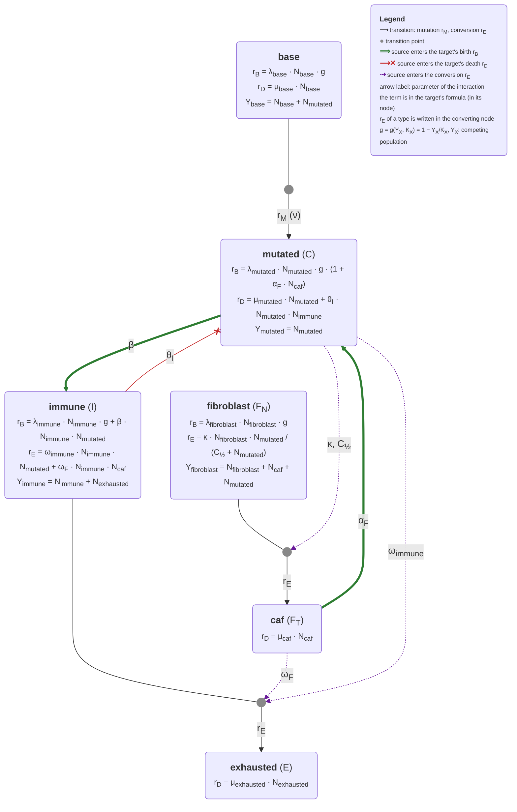

# Plan: añadir fibroblastos (F_N, F_T) al Gillespie

> Estado: **fases 0–3 implementadas** (con los tests unitarios de la fase 5),
> a partir del prototipo `docs/fibroblastos_prototype.patch`. Pendiente: fase 4
> (CLI, `scaling_calculator`, config de ejemplo, notebooks y gráficas) y la
> validación de la fase 5. Con los fibroblastos apagados, una simulación con
> semilla da exactamente la misma trayectoria que antes
> (`test_seeded_trajectory_is_unchanged`).

La notación sigue [`NOTATION.md`](NOTATION.md). Hay dos capas:

- **Campo medio**: la que usan el informe (`main.pdf`, ec. 4), `scaling_calculator.py` y `notebooks/omega_convergence.py`. Poblaciones C, I, E.
- **Gillespie**: la que usan `README.md` y el póster. Tasas `r_B, r_D, r_M, r_E`, cuentas `N_<tipo>`. El crowding es `g(Y, K_X) = 1 − Y/K_X` (en campo medio se escribe el factor logístico explícito).

Los fibroblastos se añaden como dos poblaciones nuevas, F_N y F_T, en las dos capas.

## 0. Resumen

No basta con «una subclase nueva en `clone.py`». Hacen falta:

1. **Dos tipos nuevos**, no uno: `fibroblast` (F_N) y `caf` (F_T). Siguen el mismo patrón que `immune` → `exhausted`.
2. **Interacciones nuevas en dos subclases que ya existen**:
   - `MutatedClone`: los CAF aumentan `r_B(mutated)`.
   - `ImmuneClone`: los CAF aumentan `r_E(immune)`.
3. **Quitar los tipos fijados a mano** fuera de `clone.py`. Si no se quitan, la conversión F_N → F_T acabaría en `exhausted`:
   - `TumorSimulation._induce_exhaustion` tiene fijado el destino `cell_parameters["exhausted"]`.
   - `CrowdingStrategy.crowding` compara con `"exhausted"`.

   Los ids ya no están fijados a mano: `CellTypeConfig.default_id` es la única fuente. `TumorSimulation.__init__` crea un clon raíz por tipo de `cell_parameters` y `csv_output.clone_id_to_str` saca los nombres de `default_id`.
4. **Parámetros nuevos** en `SimulationConfig`, con su escalado por `OMEGA`.

---

## 1. Notación

### 1.1 Poblaciones

| Tipo (código) | Campo medio | Gillespie | Del cuaderno |
|---|---|---|---|
| `base` | (no aparece en el modelo de 3 poblaciones) | `N_base` | — |
| `mutated` | C | `N_mutated` | C |
| `immune` | I | `N_immune` | T_A |
| `exhausted` | E | `N_exhausted` | E |
| `fibroblast` | **F_N** | `N_fibroblast` | f_N |
| `caf` | **F_T** | `N_caf` | f_T |

En campo medio el crowding se escribe explícito, como factor logístico: `(1 − C/K_C)`, `(1 − (I + E)/K_I)`, `(1 − (w_N F_N + w_T F_T + w_C C)/K_F)`, con las capacidades sin escalar. En Gillespie se escribe `g(Y, K_X) = 1 − Y/K_X`: `Y` es la población que compite con el tipo X (la suma que devuelve `crowding_numerator()`) y `K_X` es la capacidad escalada (`actual_K`: × `OMEGA` e inflada por `AdaptedCrowding`). El código la limita a `max(0, g)`. No se usa el `C(t)` antiguo del README. La población tumoral se escribe C en campo medio y `N_mutated` en Gillespie.

### 1.2 Parámetros

Los parámetros nuevos siguen el patrón de los existentes. Las tasas propias llevan el subíndice del tipo (λ_C, μ_E → λ_F, μ_F). La capacidad es K_tipo (K_C, K_I → K_F). Las interacciones son letras griegas: sin subíndice si las causa C (β, ω) y con subíndice si las causa otro tipo (θ_I → ω_F, α_F).

| Cuaderno | Dimensional | Adimensional (ec. 4: tasas / λ_C) | Gillespie (código) | Escalado |
|---|---|---|---|---|
| r_F | λ_F | ρ_F = λ_F / λ_C | `cell_parameters["fibroblast"].lambda0` | — |
| K | K_F | k = K_C / K_F | `cell_parameters["fibroblast"].K` | fracción de `OMEGA`, × `OMEGA` |
| d_F | μ_F | μ_F / λ_C | `cell_parameters["caf"].mu` | — |
| κ (ec. f_N, f_T) | κ | κ / λ_C | `kappa` | **no se escala** (Michaelis–Menten) |
| K₀ | C_½ | c_½ = C_½ / K_C | `C_half` | fracción de `OMEGA`, × `OMEGA` |
| κ (ec. E) | ω | ω K_C / λ_C | `cell_parameters["immune"].omega_exhaust` | ÷ `OMEGA` (ya existe) |
| κ̂ | ω_F | ω_F K_F / λ_C | `omega_F` | ÷ `OMEGA` |
| d_E | μ_E | μ_E / λ_C | `cell_parameters["exhausted"].mu` | — (ya existe) |
| — (solo flecha) | α_F | α_F K_F | `alpha_F` | ÷ `OMEGA` |

Valores por defecto: `N_fibroblast = N_caf = 0` y `kappa = omega_F = alpha_F = 0`. Así el módulo queda inerte y el modelo actual se reproduce sin cambios.

---

## 2. Ecuaciones

### 2.1 Campo medio, dimensional

Es el sistema del informe, ampliado. Las ecuaciones de $F_N$ y $F_T$ son nuevas; en las de $C$, $I$ y $E$ los términos nuevos van recuadrados.

Opcion A:

```math
\begin{aligned}
\frac{dC}{dt}   &= \lambda_C\, C \left(1 - \frac{C}{K_C}\right) \boxed{(1 + \alpha_F F_T)} - \mu_C C - \theta\, C I \\
\frac{dI}{dt}   &= \lambda_I\, I \left(1 - \frac{I + E}{K_I}\right) + \beta\, C I - \omega\, C I {- \omega_F\, F_T I} \\
\frac{dE}{dt}   &= \omega\, C I {+ \omega_F\, F_T I} - \mu_E E \\
\frac{dF_N}{dt} &= \lambda_F\, F_N \left(1 - \frac{w_N F_N + w_T F_T + w_C C}{K_F}\right) - \kappa\, F_N \frac{C}{C_{1/2} + C} \\
\frac{dF_T}{dt} &= \kappa\, F_N \frac{C}{C_{1/2} + C} - \mu_F F_T
\end{aligned}
```
Opcion B:
```math
\begin{aligned}
\frac{dC}{dt}   &= \lambda_C\, C \left(1 - \frac{C}{K_C}\right) \boxed{+ C \alpha_F F_T} - \mu_C C - \theta\, C I \\
\frac{dI}{dt}   &= \lambda_I\, I \left(1 - \frac{I + E}{K_I}\right) + \beta\, C I - \omega\, C I {- \omega_F\, F_T I} \\
\frac{dE}{dt}   &= \omega\, C I {+ \omega_F\, F_T I} - \mu_E E \\
\frac{dF_N}{dt} &= \lambda_F\, F_N \left(1 - \frac{w_N F_N + w_T F_T + w_C C}{K_F}\right) - \kappa\, F_N \frac{C}{C_{1/2} + C} \\
\frac{dF_T}{dt} &= \kappa\, F_N \frac{C}{C_{1/2} + C} - \mu_F F_T
\end{aligned}
```

Las poblaciones se miden en células y el tiempo en las unidades de las tasas.

| Parámetro | Significado | Unidades |
|---|---|---|
| $\lambda_C$ | tasa de división de las células tumorales | 1/tiempo |
| $\mu_C$ | tasa de muerte de las células tumorales | 1/tiempo |
| $K_C$ | capacidad de carga del tumor | células |
| $\theta$ | tasa de muerte de células tumorales por las inmunes activas | 1/(célula · tiempo) |
| $\lambda_I$ | tasa de división de las inmunes activas | 1/tiempo |
| $K_I$ | capacidad de carga de las inmunes (activas + agotadas) | células |
| $\beta$ | activación de las inmunes por accion tumoral | 1/(célula · tiempo) |
| $\omega$ | agotamiento de las inmunes por el tumor | 1/(célula · tiempo) |
| $\mu_E$ | tasa de muerte de las inmunes agotadas | 1/tiempo |
| $\lambda_F$ | tasa de división de los fibroblastos normales | 1/tiempo |
| $K_F$ | capacidad de carga del nicho de fibroblastos (compartido con el tumor) | células |
| $\kappa$ | tasa máxima de activación de un fibroblasto a CAF, la que se alcanza con un tumor muy grande ($C \gg C_{1/2}$) | 1/tiempo |
| $C_{1/2}$ | tamaño del tumor con el que la tasa de activación de fibroblastos vale $\kappa/2$ | células |
| $\mu_F$ | tasa de muerte de los CAF | 1/tiempo |
| $\omega_F$ | agotamiento de las inmunes por los CAF | 1/(célula · tiempo) |
| $\alpha_F$ | aumento de la división tumoral por cada CAF | 1/célula |
| $w_N$, $w_T$, $w_C$ | peso (share) de un fibroblasto / un CAF / una célula tumoral en el numerador del crowding del nicho de fibroblastos; ningún tipo es la referencia (por defecto 1: todos pesan igual) | adimensional |

### 2.2 Campo medio, adimensional

Se usa el mismo cambio que en la ec. 4:

```math
c = \frac{C}{K_C},\quad i = \frac{I}{K_I},\quad e = \frac{E}{K_I},\quad
f_N = \frac{F_N}{K_F},\quad f_T = \frac{F_T}{K_F},\quad \tau = \lambda_C t
```

Los nombres siguen `DimensionlessParameters`, que reutiliza $\beta$, $\omega$ y $\mu_E$ para los grupos adimensionales.

```math
\begin{aligned}
\frac{dc}{d\tau}   &= c\,(1 - c)\,(1 + \alpha_F f_T) - \gamma_C\, c - \sigma\, c\, i \\
\frac{di}{d\tau}   &= \rho\, i\,(1 - i - e) + (\beta - \omega)\, c\, i - \omega_F\, f_T\, i \\
\frac{de}{d\tau}   &= \omega\, c\, i + \omega_F\, f_T\, i - \mu_E\, e \\
\frac{df_N}{d\tau} &= \rho_F\, f_N\,(1 - w_N f_N - w_T f_T - k\, w_C\, c) - \kappa\, f_N \frac{c}{c_{1/2} + c} \\
\frac{df_T}{d\tau} &= \kappa\, f_N \frac{c}{c_{1/2} + c} - \mu_F\, f_T
\end{aligned}
```

Grupos nuevos ($\leftarrow$: el grupo reutiliza el nombre del parámetro dimensional):

```math
\rho_F = \frac{\lambda_F}{\lambda_C},\quad
k = \frac{K_C}{K_F},\quad
c_{1/2} = \frac{C_{1/2}}{K_C},\quad
\kappa \leftarrow \frac{\kappa}{\lambda_C},\quad
\mu_F \leftarrow \frac{\mu_F}{\lambda_C},\quad
\omega_F \leftarrow \frac{\omega_F K_F}{\lambda_C},\quad
\alpha_F \leftarrow \alpha_F K_F
```

El término $k\,w_C\,c$ aparece porque en el cuaderno $C$ ocupa el nicho de los fibroblastos (ver §5.1). Los pesos $w_N$, $w_T$, $w_C$ ya son adimensionales y no cambian al adimensionalizar; con $w_N = w_T = w_C = 1$ (valor por defecto) se recupera el sistema sin pesos.

### 2.3 Gillespie: tasas efectivas por clon

Formato del README. La forma base no cambia:

```math
r_B = \lambda\, N\, g(Y_X, K_X), \qquad r_D = \mu\, N, \qquad r_M = \nu\, N\,(1 + \text{instability}), \qquad r_E = \omega\, N
```

Los términos nuevos en clases que ya existían van recuadrados. En estas fórmulas $C_{1/2}$, $\omega_F$ y $\alpha_F$ son los valores ya escalados (ver el final de esta sección).

#### `FibroblastClone` (nuevo)

```math
\begin{aligned}
r_B(\text{fibroblast}) &= \lambda_{\text{fibroblast}}\, N_{\text{fibroblast}}\; g(Y_{\text{fibroblast}}, K_{\text{fibroblast}}),
\qquad Y_{\text{fibroblast}} = w_N\, N_{\text{fibroblast}} + w_T\, N_{\text{caf}} + w_C\, N_{\text{mutated}} \\
r_E(\text{fibroblast}) &= \kappa\, N_{\text{fibroblast}}\, \frac{N_{\text{mutated}}}{C_{1/2} + N_{\text{mutated}}}
\qquad (\text{fibroblast} \to \text{caf})
\end{aligned}
```

#### `CAFClone` (nuevo)

```math
r_B(\text{caf}) = 0, \qquad r_D(\text{caf}) = \mu_{\text{caf}}\, N_{\text{caf}}
```

#### `MutatedClone` (término nuevo en $r_B$)

```math
\begin{aligned}
r_B(\text{mutated}) &= \lambda_{\text{mutated}}\, N_{\text{mutated}}\; g(Y_{\text{mutated}}, K_{\text{mutated}})\, \boxed{(1 + \alpha_F\, N_{\text{caf}})} \\
r_D(\text{mutated}) &= \mu_{\text{mutated}}\, N_{\text{mutated}} + \theta_I\, N_{\text{mutated}}\, N_{\text{immune}} \qquad (\text{sin cambios})
\end{aligned}
```

#### `ImmuneClone` (término nuevo en $r_E$)

```math
r_E(\text{immune}) = \omega_{\text{immune}}\, N_{\text{immune}}\, N_{\text{mutated}} \boxed{+ \omega_F\, N_{\text{immune}}\, N_{\text{caf}}}
```

El evento `EXHAUSTION` pasa a ser una conversión genérica: una célula del clon se convierte en una célula del tipo `converts_to`. Para `immune` ese destino es `exhausted` y para `fibroblast` es `caf`.

El escalado sigue la regla del README («scales `beta` and `theta_I` by `OMEGA`; scales carrying capacity `K`»):

- Los términos bilineales (`omega_F`, `alpha_F`) se dividen por `OMEGA`.
- `C_half` se introduce como fracción de `OMEGA`, igual que `K`, y se multiplica por `OMEGA`.
- `kappa` no se escala, porque la fracción $N_{\text{mutated}} / (C_{1/2} + N_{\text{mutated}})$ ya no depende de `OMEGA`.

### 2.4 Equilibrios útiles para validar

- Sin tumor ($C = 0$): $F_N^* = K_F$ y $F_T^* = 0$. Para empezar en homeostasis, `N_fibroblast` inicial debe ser `K_F · OMEGA`.
- Con $C$ constante:

```math
F_T^* = \frac{\kappa\, F_N^*\, C}{\mu_F\,(C_{1/2} + C)}
```

---

## 3. Diagrama del modelo

Se genera desde el código con `scripts/model_diagram.py`. El script lee:

- `Clone._registry`,
- el AST de cada subclase,
- `_DEFAULT_CELL_PARAMETERS`.

Cada `pop_map.get("x")` dentro de un método de tasa se convierte en una arista, etiquetada con el símbolo (del README) del parámetro que la multiplica.

```bash
python -m scripts.model_diagram --write --svg   # regenera docs/model_diagram.{mmd,svg} y el bloque 3.1
python -m scripts.model_diagram --check         # lo usa tests/gillespie/test_model_diagram.py
```

Leyenda:

- ⟹ verde: suma a `r_B` del destino.
- ✕ rojo: suma a `r_D` del destino.
- ⋯▸ morado: entra en `r_E` de la conversión marcada con ●; la etiqueta es el parámetro que multiplica a la población de origen.
- `Y_X`: población que compite con el tipo X en el crowding, g(Y_X, K_X).
- Entre paréntesis, el símbolo de campo medio del tipo (C, I, E, F_N, F_T).

### 3.1 Estado actual (automático, se regenera)

<!-- model-diagram:start -->

<!-- model-diagram:end -->


## 4. Plan de implementación

Cada fase va en un commit aparte, con los tests en verde.

### Fase 0: diagrama automático (ya incluido)

- Ficheros: `scripts/model_diagram.py`, `docs/model_diagram.{mmd,svg}` y `tests/gillespie/test_model_diagram.py`.
- Añadir al `makefile`:
  ```make
  diagram:
  	.venv/bin/python -m scripts.model_diagram --write --svg
  ```
- Opcional: poner los marcadores `model-diagram:start` / `model-diagram:end` en `docs/ARCHITECTURE.md`.

### Fase 1: generalizar la conversión (sin cambiar el comportamiento)

| Fichero | Cambio |
|---|---|
| `simulation_config.py` | Añadir `CellTypeConfig.converts_to: str = ""` y `immune.converts_to = "exhausted"`. Propagarlo en `_create_scaled_cell_config` |
| `clone.py` | En `Clone.__init__`: `self.converts_to = self.cell_parameters.converts_to` |
| `tumor_simulation.py` | `_induce_exhaustion`: el destino pasa a ser `cell_parameters[clone.converts_to].default_id`, no `cell_parameters["exhausted"]`. Sin `converts_to`, `ValueError` |
| `clone_factory.py` | Quitar los imports de clases que no se usan (se mantiene `MutatedClone`, que usa la rama `mutated_test`); el registro ya resuelve la clase |
| `crowding_strategy.py` | (Opcional) quitar `if get_type()=="exhausted"`. `calculate_K` ya devuelve ∞ cuando λ = 0 |

**Comprobación**: la suite actual en verde, y una simulación con semilla idéntica a la de `main`.

Hecho (04-11-2026, fase 0.3 de `PLAN_tau_leaping.md`): `EXHAUSTION` → `CONVERSION`, `exhaustion_rate_effective` → `conversion_rate_effective` y `_induce_exhaustion` → `_induce_conversion`. La clave `"re"` se mantiene en los snapshots y en el parquet; `event_kind` en el parquet de depuración pasa a valer `"conversion"`.

### Fase 2: tipos nuevos

`simulation_config.py`:

```python
"fibroblast": CellTypeConfig(default_id=(-4,), N=0, K=1, lambda0=0.005, mu=0.0, converts_to="caf"),  # λ_F, K_F
"caf":        CellTypeConfig(default_id=(-5,), N=0, lambda0=0.0, mu=0.002),                            # μ_F
# SimulationConfig
kappa: float = 0.0     # κ, no se escala
C_half: float = 0.1    # C_½, fracción de OMEGA → × OMEGA en _scale_interaction_parameters
omega_F: float = 0.0   # ω_F, ÷ OMEGA
alpha_F: float = 0.0   # α_F, ÷ OMEGA
```

`clone.py`:

```python
class FibroblastClone(Clone, clone_type="fibroblast"):
    def crowding_numerator(self, tissue_state):
        pop_map = tissue_state.pop_map
        return pop_map.get("fibroblast", 0) + pop_map.get("caf", 0) + pop_map.get("mutated", 0)

    def exhaustion_rate_effective(self, tissue_state):
        """r_E(fibroblast) = κ · N_fibroblast · N_mutated / (C_½ + N_mutated)"""
        n_cancer = tissue_state.pop_map.get("mutated", 0)
        denom = self.config.C_half + n_cancer
        return 0.0 if denom <= 0 else self.config.kappa * self.N * n_cancer / denom

class CAFClone(Clone, clone_type="caf"):
    def crowding_numerator(self, tissue_state): return 0
    def birth_rate_effective(self, tissue_state): return 0.0
```

### Fase 3: interacciones en las subclases existentes

```python
# MutatedClone: r_B(mutated) = λ_mutated · N_mutated · g(Y_mutated, K_mutated) · (1 + α_F · N_caf)
def birth_rate_effective(self, tissue_state):
    n_caf = tissue_state.pop_map.get("caf", 0)
    return super().birth_rate_effective(tissue_state) * (1.0 + self.config.alpha_F * n_caf)

# ImmuneClone.exhaustion_rate_effective: + ω_F · N_immune · N_caf
n_caf = tissue_state.pop_map.get("caf", 0)
caf_exhaustion = self.N * n_caf * self.config.omega_F
return base_exhaustion * n_cancer + caf_exhaustion
```

El término se escribe en dos pasos (`n_caf = pop_map.get(...)` y luego `… * self.config.<param>`). Así el generador del diagrama puede asignar cada parámetro a su arista.

### Fase 4: infraestructura y documentación

- `cli_config.py`: añadir `--kappa`, `--C-half`, `--omega-F` y `--alpha-F`, y sus entradas en `_config_defaults`. Por JSON ya funcionan.
- `scaling_calculator.py`:
  - `PhysicalParameters`: añadir `lambda_F, mu_F, K_F, kappa, C_half, omega_F, alpha_F, F_N0, F_T0`.
  - `DimensionlessParameters`: añadir `rho_F, k, c_half, kappa, mu_F, omega_F, alpha_F`.
  - Implementar las conversiones de §2.2 en ambos sentidos.
- `configs/fibroblasts.json`: ejemplo con `N_fibroblast = K_F · OMEGA`.
- `README.md` (secciones *Overview* y *Clone-specific interaction terms*) y `docs/ARCHITECTURE.md`: pasar de cuatro tipos a seis y añadir las fórmulas de §2.3.
- `notebooks/omega_convergence.py`: ampliar `ode_rhs` y las propensiones con F_N y F_T para la validación.
- Gráficas (`notebooks/visualization/*`): colores para `fibroblast` y `caf`.

### Fase 5: tests y validación

Tests unitarios, ya incluidos en el patch como `tests/gillespie/test_fibroblasts.py`:

- con los valores por defecto el módulo está apagado;
- `Y_fibroblast = N_fibroblast + N_caf + N_mutated`;
- `r_E(fibroblast)` sigue Michaelis–Menten, y `C_half` se escala × `OMEGA`;
- el evento de conversión mueve una célula de `fibroblast` a `caf`;
- `r_B(caf) = 0` y `r_D(caf) = μ_F · N_caf`;
- `r_E(immune)` suma `ω_F · N_immune · N_caf`;
- `r_B(mutated)` se multiplica por `(1 + α_F · N_caf)`.

Tests de regresión:

- con el módulo apagado, la misma semilla da la misma trayectoria;
- `test_config_service` pasa a esperar seis tipos.

Validación del modelo, siguiendo el esquema de `omega_convergence.py`:

1. Solo fibroblastos (C = 0): la media de `N_fibroblast` converge a `K_F · OMEGA`.
2. Con C fijo: `N_caf` converge al valor de §2.4.
3. Sistema completo: la media sobre varias semillas, a distintos `OMEGA`, converge a la solución de §2.2.

---

## 5. Decisiones

Respuestas del 03-11-2026.

### Cerradas

1. **Crowding asimétrico: intencionado.** C ocupa el nicho de los fibroblastos (`N_mutated` está en `Y_fibroblast`, de donde sale el término $k\,c$), pero los fibroblastos no frenan a C: `Y_mutated = N_mutated`.
4. **No hay vuelta F_T → F_N.** La activación es irreversible; los CAF solo salen por muerte ($\mu_F$).
5. **Los F_T solo actúan sobre I a través del agotamiento** ($\omega_F$). No cambian $\theta$ ni otras tasas de I por ahora.

### Abiertas

2. **Forma del término F_T → C.** El cuaderno tiene la flecha pero no la ecuación. Implementado de momento: factor lineal $(1 + \alpha_F F_T)$ sobre la natalidad. Alternativas: saturante, $(1 + \alpha_F F_T/(F_{1/2} + F_T))$, o que el efecto vaya sobre $\mu_C$ o $K_C$ en lugar de la natalidad.
3. **¿Mueren los F_N?** El cuaderno no tiene término de muerte. Implementado de momento: no mueren. Si se añade $\mu_{\text{fibroblast}} > 0$, `AdaptedCrowding` inflará $K_F$ y sería un octavo parámetro.
6. **Valores físicos** de $\lambda_F$, $K_F$, $\mu_F$, $\kappa$, $C_{1/2}$, $\omega_F$ y $\alpha_F$, para el `scaling_calculator`. Pendiente de confirmar.
7. **Forma de la activación F_N → F_T.** Implementado: Michaelis–Menten, $\kappa F_N C/(C_{1/2} + C)$. Alternativa: acción de masas, $\kappa F_N C$ (un parámetro menos, $\kappa$ ÷ `OMEGA` como el resto de interacciones). Solo hay diferencia apreciable si $c_{1/2} = C_{1/2}/K_C \lesssim 1$; si el tumor es pequeño frente a $C_{1/2}$, solo importa $\kappa/C_{1/2}$ y los dos parámetros no se pueden separar.
