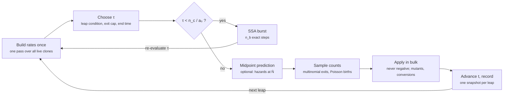

# Plan: multinomial tau-leaping for the Gillespie simulator

> Status: **Phase 0 done** (merged in PR #3, 04-11-2026), **Phase 1 done**
> (branch `tau-phase1`, 09-11-2026, not merged yet). Phases 2–4 not started. First written on 28-10-2026,
> before the fibroblast module (`fibroblast` F_N, `caf` F_T, commit `34475c1`),
> and revised for it.

## 0. Summary

- Replace the one-event-per-step SSA with a **per-clone binomial–multinomial tau-leap**: one multinomial per clone for the cells that leave (death, mutation, conversion) and one Poisson per clone for births.
- Populations can never go negative. The means equal the Poisson leap's. When a step would buy fewer than ~10 events, the step runs as an exact SSA burst.
- It plugs in as a second `Stepper` next to the current one, so `stepper="ssa"` keeps today's results bit for bit.
- Optional midpoint correction (`tau_midpoint=True`, Tian & Burrage scheme 2) for a better mean during tumour growth.
- The model now has six types (`base`, `mutated`, `immune`, `exhausted`, `fibroblast`, `caf`). The fibroblast reactions already follow the contract in §8, so the leaping code needs no type-specific branch for them. They do change three things in the plan: the observable set (§5, step 1), the exit cap when κ or ω_F is large (§5, step 6), and the validation scenarios (§9).
- New phenotypes need no changes in the leaping code either, as long as their reactions follow the contract in §8.

## 1. Context and goal

What the simulator does today (`src/gillespie/tumor_simulation.py`):

1. `_build_rate_matrix()` loops over every live clone and creates up to 4 `Event`s (birth, death, mutation, conversion). Each carries a total propensity a = n_i × (per-cell rate). The conversion is already generic: `_induce_exhaustion` moves one cell to the root clone of `clone.converts_to` (`immune` → `exhausted`, `fibroblast` → `caf`).
2. `step()` draws one waiting time from a_0, picks one event with `choose_event`, applies it, and **rebuilds the whole rate matrix**.
3. So every single cell event costs O(number of clones) Python work. Almost all wall time goes into rebuilding the same rates after a ±1 change.

The code already anticipates this. `RateMatrix.get_reaction_number_poisson` is a Poisson stub marked "(LONG TERM) implementar tau leap". `TumorSimulation.__init__` has a note to add a strategy for the leap type ("Binomial, Poisson, Poisson half"). This plan fills that slot.

Design constraints:

- **Scalable**: new tumour phenotypes must work with no change to the leaping code, as the fibroblast module (`fibroblast` F_N, `caf` F_T, see `docs/PLAN_fibroblastos.md`) now has to.
- **Off means identical**: with the fibroblast module off (its default, `N = 0` and `kappa = omega_F = alpha_F = 0`), the leaper must behave as on the four-type model. Zero-rate channels add no events and dead clones add no rows.
- **Upgradeable**: the leap method (Poisson, binomial, midpoint, type-aggregated, numba) is swappable behind one interface.
- **Minimal**: reuse the `Clone` rate methods, `RateMatrix`, `_apply_event`, and the config pattern already used for `CrowdingStrategy`.

## 2. Notation: the model as a reaction network

Symbols follow `docs/NOTATION.md` (Gillespie layer: `N_<type>`, `r_B, r_D, r_M, r_E`, crowding `g(Y, K_X)`). Where the tau-leaping literature uses letters that already mean something in the model, this plan renames them: firing counts are `R_j` (as `Event.reaction_number`; T&B and CGP call them K_j), state-change vectors are `s_j` (their ν_j; ν is the mutation rate here), and the CGP drift and variance of an observable are `d_k` and `v_k` (their μ_k, σ_k²).

Every reaction in the model has the same shape. **A cell of clone i does something, at a per-cell rate that depends only on the type totals and on time.** That single property makes the multinomial leap exact per clone. It also lets the step-size control work on a handful of type-level quantities.

- Clones i = 1…M. Each has a type T(i) ∈ {`base`, `mutated`, `immune`, `exhausted`, `fibroblast`, `caf`, …} and n_i cells. (Mean-field symbols: `mutated` = C, `immune` = I, `exhausted` = E, `fibroblast` = F_N, `caf` = F_T.)
- Type totals: N_T = Σ n_i over the clones of type T, i.e. `N_base`, `N_mutated`, `N_immune`, `N_exhausted`, `N_fibroblast`, `N_caf`. This is `pop_map`.
- Crowding of type X: $g(Y_X, K_X) = 1 - Y_X / K_X$, clamped at 0 in the code. Y_X = Σ_T w_T N_T over the types in X's crowding pool (`CellTypeConfig.crowding_pool = {T: w_T}`, `crowding_numerator()`; default weights 1). K_X is the scaled carrying capacity `actual_K`, already × OMEGA and inflated by `AdaptedCrowding`. Types that do not divide (`exhausted`, `caf`) have K_X = ∞ and g = 1.
- Each channel r of clone i has propensity $a_{i,r} = n_i \, h_{T(i),r}(N, t)$, where h is the **per-cell hazard**. The mutation channel also multiplies by $m_i = 1 + \text{instability}_i$.

The current channels (`src/gillespie/clone.py`), with the scaled parameters stored in `SimulationConfig`. Terms added by the fibroblast module are in **bold**:

| Clone type | Channel | Per-cell hazard h | Effect on clone i | Effect on type totals | Consumes a cell of i? |
| --- | --- | --- | --- | --- | --- |
| `base` | birth (r_B) | λ_base g(Y_base, K_base), Y_base = N_base + N_mutated | n_i + 1 | N_base + 1 | no |
| `base` | death (r_D) | μ_base | n_i − 1 | N_base − 1 | yes |
| `base` | mutation (r_M) | ν m_i | n_i − 1, new `mutated` clone with 2 cells | N_base − 1, N_mutated + 2 | yes |
| `mutated` | birth (r_B) | λ_mutated g(Y_mutated, K_mutated) **(1 + α_F N_caf)**, Y_mutated = N_mutated | n_i + 1 | N_mutated + 1 | no |
| `mutated` | death (r_D) | μ_mutated + θ_I N_immune | n_i − 1 | N_mutated − 1 | yes |
| `immune` | birth (r_B) | λ_immune g(Y_immune, K_immune) + β N_mutated, Y_immune = N_immune + N_exhausted | n_i + 1 | N_immune + 1 | no |
| `immune` | conversion (r_E, exhaustion) | ω N_mutated **+ ω_F N_caf** | n_i − 1, `exhausted` root clone + 1 | N_immune − 1, N_exhausted + 1 | yes |
| `exhausted` | death (r_D) | μ_exhausted | n_i − 1 | N_exhausted − 1 | yes |
| **`fibroblast`** | birth (r_B) | λ_fibroblast g(Y_fibroblast, K_fibroblast), Y_fibroblast = N_fibroblast + N_caf + N_mutated | n_i + 1 | N_fibroblast + 1 | no |
| **`fibroblast`** | conversion (r_E, activation) | κ N_mutated / (C_½ + N_mutated) | n_i − 1, `caf` root clone + 1 | N_fibroblast − 1, N_caf + 1 | yes |
| **`caf`** | death (r_D) | μ_caf (= μ_F) | n_i − 1 | N_caf − 1 | yes |

Channels with zero rate by default are omitted: `immune` and `fibroblast` death (μ = 0), mutation of every type except `base` (ν = 0), births of `exhausted` and `caf` (λ = 0). They still get a column in the leap (§6), with probability 0. C_½, ω_F and α_F are the values already scaled by `SimulationConfig` (C_½ × OMEGA, ω_F and α_F ÷ OMEGA); κ is not scaled.

Three things to notice:

1. **Interactions are catalytic.** Immune killing is a `mutated` death whose hazard depends on N_immune; the immune cell is not consumed. Exhaustion depends on N_mutated and N_caf; neither the tumour cell nor the CAF is consumed. Fibroblast activation depends on N_mutated; the tumour cell is not consumed. CAF support of tumour birth multiplies a birth hazard. So every channel consumes at most one cell, and only from its own clone.
2. **Channels come in two kinds.** Births only add cells. Death, mutation and conversion (`immune` → `exhausted`, `fibroblast` → `caf`) remove one cell of clone i. Only the second kind can drive n_i negative.
3. **Conversions go to one root clone per type.** Every conversion adds its cell to the `default_id` clone of `converts_to`. `exhausted` and `caf` therefore have a single clone each, and `fibroblast` has a single clone unless a phenotype mutation is added later.

In stoichiometric form, each channel j has a state-change vector s_j over the type totals (the second-to-last column). The leap needs only three things from each channel: its propensity a_j, whether it consumes a cell, and s_j.

## 3. Derivation 1: from the SSA to Poisson tau-leaping

Poisson tau-leaping is the SSA with propensities frozen over a step of length τ. It is first-order accurate, but it can remove more cells than a clone has.

**Step 1. The SSA (what `step()` does now).** With total propensity a_0:

```math
a_0(x) = \sum_j a_j(x), \qquad \Delta t \sim \mathrm{Exp}(a_0), \qquad \Pr(\text{channel } j) = \frac{a_j(x)}{a_0(x)}
```

Equivalently, each channel j is an independent Poisson process with rate a_j(x(t)), and the rate changes after every event.

**Step 2. Freeze the rates.** Assume the leap condition: over [t, t + τ) no propensity changes appreciably. Then each channel is a Poisson process with a constant rate:

```math
R_j \sim \mathrm{Poisson}\big(a_j(x)\,\tau\big), \qquad x(t+\tau) = x(t) + \sum_j s_j R_j
```

The mean update is the forward-Euler step of the deterministic rate equations: E[x(t + τ)] = x + τ Σ_j s_j a_j(x). The local error is O(τ²), from the drift of a_j inside the step.

**Step 3. Why plain Poisson fails here.** A Poisson count is unbounded. For the death channel of a small clone:

```math
\Pr(R_{\text{death}} > n_i) = 1 - \sum_{k=0}^{n_i} e^{-a\tau}\frac{(a\tau)^k}{k!} > 0
```

Several consuming channels of the same clone add up (death + mutation, death + immune killing). Mutant clones are born with n = 2, so this is the common case, not an edge case. Clamping n_i at 0 (what `kill()` does today) silently biases extinction. Binomial and multinomial leaps remove the problem at its source.

## 4. Derivation 2: binomial and multinomial leaps

Result: for each clone, draw **one multinomial** over "stay / leave by death / leave by mutation / leave by conversion", with probabilities h_r τ. Draw **one Poisson** for births. The means equal the Poisson leap's, and no clone can lose more cells than it has.

**Step 1. One channel (Tian & Burrage 2004, eq. 8–9).** For a first-order channel that consumes species x_1, replace the Poisson count by a binomial with the same mean:

```math
R_j \sim \mathrm{Bin}\!\left(N_j,\; \frac{a_j(x)\,\tau}{N_j}\right), \qquad N_j = x_1, \qquad 0 \le \frac{a_j(x)\,\tau}{N_j} \le 1
```

Because R_j ≤ N_j, one channel alone can never overdraw. For a second-order channel that consumes both reactants, T&B use N_j = min(x_1, x_2) (eq. 10). We do not need that case today, because all interactions are catalytic (§2).

**Step 2. Several channels drain the same clone (T&B eq. 12–15).** Two independent Poissons sum to a Poisson, and conditional on the sum, one of them is binomial:

```math
P_j + P_k \sim \mathrm{Poisson}\big((a_j + a_k)\tau\big), \qquad P_j \mid (P_j + P_k = R) \sim \mathrm{Bin}\!\left(R,\; \frac{a_j}{a_j + a_k}\right)
```

T&B replace the total by a binomial on the shared reactant, then split it. Pettigrew & Resat (2007) generalise the split to any number of channels with a multinomial.

**Step 3. Specialise to our per-cell hazards.** For clone i, let out(i) be its consuming channels and H_i their summed per-cell hazard. Since a_{i,r} = n_i h_r, the T&B probability is a_{i,r} τ / n_i = h_r τ. First the total exits, then the split:

```math
H_i = \sum_{r \in \mathrm{out}(i)} h_r, \qquad R_i^{\mathrm{out}} \sim \mathrm{Bin}(n_i,\, H_i \tau), \qquad (R_{i,r})_{r} \mid R_i^{\mathrm{out}} \sim \mathrm{Mult}\!\left(R_i^{\mathrm{out}};\, \frac{h_r}{H_i}\right)
```

The two stages collapse into a single draw. That is one NumPy call for all clones at once:

```math
\big(R_{i,\mathrm{stay}},\, R_{i,r_1},\, \dots,\, R_{i,r_m}\big) \sim \mathrm{Mult}\big(n_i;\; 1 - H_i\tau,\; h_{r_1}\tau,\; \dots,\; h_{r_m}\tau\big)
```

Intuition: each of the n_i cells independently either survives the step or leaves through exactly one channel. Births consume nothing, so they stay Poisson:

```math
R_{i,\mathrm{birth}} \sim \mathrm{Poisson}\big(n_i\, h_{\mathrm{birth}}\, \tau\big)
```

**Step 4. Moments.** For a consuming channel r of clone i:

```math
\mathbb{E}[R_{i,r}] = a_{i,r}\tau, \qquad \mathrm{Var}[R_{i,r}] = a_{i,r}\tau\,(1 - h_r\tau), \qquad \mathrm{Cov}[R_{i,r}, R_{i,s}] = -\,n_i\, h_r h_s\, \tau^2
```

The mean is exactly the Poisson leap's, so the drift is still the Euler step. The variance is smaller by a factor (1 − h_r τ), and channels of the same clone become negatively correlated. That is the price of the cap n_i.

**Step 5. Two design choices that follow.**

- **Use p = h τ, not p = 1 − e^{−hτ}.** The exponential form is exact for a pure-death clone, but it compounds deaths while Poisson births stay linear in τ. Take the defaults with `base` at homeostasis (n = 4000, λ g = μ = 0.002, τ = 225). The exponential form gives 1449 expected deaths against 1800 births: a spurious drift of +350 cells per step. The linear form keeps births and deaths on the same Euler footing.
- **Cap the per-cell exit probability: H_i τ ≤ p_max.** T&B only require ≤ 1. But the variance deficit in Step 4 is a fraction H_i τ of the true value, which would be 45% at τ = 225 above. A cap p_max = 0.1 keeps the deficit under 10% and costs little speed (§5).

**Step 6. Structural effects.** After drawing K:

- n_i ← n_i − R_i^out + R_{i,birth}. Never negative by construction.
- R_{i,mutation} mutations create R_{i,mutation} **new** clones of type `next_mutation`. Each has 2 cells and its own `next_child_id()`.
- R_{i,conversion} conversions add R_{i,conversion} cells to the root clone of the target type, `cell_parameters[converts_to].default_id`, as `_induce_conversion` already does one cell at a time. The same code path serves exhaustion (`immune` → `exhausted`) and activation (`fibroblast` → `caf`).

**Step 7. Optional midpoint correction** (`tau_midpoint=True`; Tian & Burrage 2004, Method 2, scheme 2). The explicit leap above evaluates every hazard at x(t). The drift of the hazards inside the step therefore leaves an O(τ²) local error in the mean. The midpoint leap evaluates the hazards at the expected state halfway through the step. Hazards depend only on type totals, so the prediction is a vector over types, not over clones:

```math
\bar N = \max\!\Big(0,\; N + \frac{\tau}{2} \sum_j s_j\, a_j(x)\Big), \qquad \bar m_i = m_i + \frac{\tau}{2}\,\big(b_0 + b_i\big)
```

Here b_0 + b_i = `base_instability_buildup` + the clone's `buildup`. Then sample with the midpoint hazards $\bar h = h(\bar N, t + \tau/2)$, but keep the caps n_i from x(t), so no clone can go negative:

```math
R_{i,\mathrm{birth}} \sim \mathrm{Poisson}\big(n_i\, \bar h_{\mathrm{birth}}\, \tau\big), \qquad \big(R_{i,\mathrm{stay}}, R_{i,r_1}, \dots\big) \sim \mathrm{Mult}\big(n_i;\; 1 - \bar H_i \tau,\; \bar h_{r_1}\tau,\; \dots\big)
```

- **Cost:** one extra pass of the rate methods per leap, with `pop_map` replaced by N̄. No extra random numbers.
- **Gain:** a better mean (drift), which is where the explicit leap is weakest during tumour growth. The variance is not improved.
- **Cap:** if a midpoint hazard breaks H̄_i τ ≤ p_max, halve τ and predict again. This should be rare, because the leap condition already keeps hazards within ε.
- **Small populations:** T&B report that the prediction misbehaves near zero populations (their §VII). Here those steps run as an SSA burst, and N̄ and g are clamped at 0 anyway.

## 5. Derivation 3: choosing τ, and when to fall back to the SSA

Result: τ is the smallest of three bounds: the type-level leap condition, the exit-probability cap, and the output/end time. If τ buys fewer than ~10 events, the step is done with the exact SSA instead.

**Step 1. Which quantities must stay nearly constant.** Hazards h depend only on the type totals N and on t (§2). A clone's own n_i enters linearly, and the multinomial treats that exactly. So the leap condition only needs to watch **linear observables of the type totals**:

- one per crowding pool: y = Y_X (Y_base = N_base + N_mutated; Y_immune = N_immune + N_exhausted; Y_fibroblast = N_fibroblast + N_caf + N_mutated). `mutated` has the singleton pool Y_mutated = N_mutated; `exhausted` and `caf` have no pool.
- one per **interaction input**: y = N_T for every type T that enters some hazard outside a crowding pool. Today these are N_immune (θ_I), N_mutated (β, ω, κ / C_½) and N_caf (α_F, ω_F).

Each observable is y_k = ℓ_k · N, with ℓ_k a vector over types: 0/1 for an interaction input, the crowding weights w_T for a pool. The formulas below only need y_k to be linear in N, not 0/1. So the list is generated automatically from the registered types, their crowding pools and their interaction inputs (Phase 0, §7).

Types that enter no hazard except through a pool (N_base, N_exhausted, N_fibroblast) need no observable of their own: the pool observable already bounds the change of g, and a clone's own n_i is handled exactly by the multinomial. This matters more with the fibroblast module. With an observable per type, any small population sets the floor b = 1 and forces the SSA fallback, even if it affects no hazard: a few `exhausted` cells early in the immune response, or a `fibroblast` population that is not the one being resolved. N_caf is an interaction input, so a small `caf` population (just after activation starts) still forces the fallback, which is right when α_F or ω_F > 0. Skipping it when both are 0 needs the pruning in §10. The old rule, "one observable per type", is the conservative fallback when a type does not declare its inputs.

**Step 2. Drift and variance of each observable's change.** This is Cao, Gillespie & Petzold (2006), applied to y_k instead of to species:

```math
d_k = \sum_j (\ell_k \cdot s_j)\, a_j(x), \qquad v_k = \sum_j (\ell_k \cdot s_j)^2\, a_j(x)
```

**Step 3. Tolerances.** For an interaction input, use the CGP bound with order factor 2 (their g_i = 2): each input enters a propensity that is bilinear in type totals (θ_I N_mutated N_immune, β N_immune N_mutated, ω_F N_immune N_caf, α_F N_mutated N_caf, …). The factor 2 is also conservative for the fibroblast terms: the relative sensitivity of the hazard to its input is at most 1, since d ln h / d ln N_mutated = C_½ / (C_½ + N_mutated) ≤ 1 for the Michaelis–Menten activation, and d ln h / d ln N_caf = α_F N_caf / (1 + α_F N_caf) ≤ 1 for the CAF support of tumour birth. For a crowding pool, bound the absolute change of the crowding g by ε. A relative bound fails near carrying capacity, where g → 0:

```math
b_{N_T} = \max\!\left(\frac{\varepsilon N_T}{2},\, 1\right), \qquad b_{Y_X} = \max\!\left(\varepsilon\, K_X,\, 1\right)
```

**Step 4. The step size.** Keep the drift d_k τ within b_k and the standard deviation √(v_k τ) within b_k. Add the exit-probability cap from §4 and the end time:

```math
\tau = \min\left\{ \min_k \left( \frac{b_k}{|d_k|},\; \frac{b_k^2}{v_k} \right),\;\; \frac{p_{\max}}{\max_i H_i},\;\; T_{\max} - t \right\}
```

**Step 5. Fallback to the exact SSA.** If the leap buys little, leaping is both less accurate and slower than the SSA. Following CGP:

```math
\text{if } \tau < \frac{n_c}{a_0}: \quad \text{do } n_b \text{ exact SSA steps, then re-evaluate} \qquad (n_c \approx 10,\; n_b \approx 100)
```

With binomial exits we do **not** need CGP's critical-reaction partition, because negativity is already impossible. Small populations are handled by the floor b ≥ 1. When a type has only a few cells (a new tumour, a collapsing immune response), its bound allows about one event, so τ drops below n_c / a_0. The stochastic phase that decides establishment or extinction then runs exactly.

**Worked example: the default config at homeostasis.** `base` only, n = 4000, K_base = 6667, λ g = μ = 0.002, ε = 0.03, p_max = 0.1, so a_0 = 16 per time unit:

| Bound | Value of τ (time units) |
| --- | --- |
| N_base, variance term (b = 60, v = 16); fallback rule only | 224 |
| N_base, drift term (d ≈ −0.08); fallback rule only | 756 |
| Y_base = N_base + N_mutated (b = 200) | 2488 |
| Exit cap p_max / (μ + ν) | 50 |

So τ = 50, and one leap replaces about 800 SSA events. In the homeostatic phase the cap dominates. During tumour growth the drift term d_k will take over, and around establishment the SSA fallback will. The real speed-up has to come from the benchmark in §9.

With the observable rule of Step 1, N_base has no observable of its own (it only enters Y_base); the two N_base rows apply only under the "one observable per type" fallback. Either way τ = 50, set by the exit cap. The fibroblast module is off by default, so this example does not change.

**Step 6. The fibroblast regime.** With the module on, three things change in the step size:

- **Fibroblast homeostasis is free.** Without a tumour, N_fibroblast sits at K_fibroblast = K_F · OMEGA (`AdaptedCrowding` does not inflate it, since μ_fibroblast = 0). There g = 0 and κ N_mutated / (C_½ + N_mutated) = 0, so the fibroblast clone has no propensity and adds no bound.
- **The exit cap can come from the conversions.** The activation hazard saturates at κ, so for a large tumour p_max / max_i H_i ≤ p_max / κ. The immune exhaustion hazard ω N_mutated + ω_F N_caf grows with both N_mutated and N_caf, without saturation. If κ or this hazard is fast compared with μ_base + ν (0.002 by default), the cap gets tighter than in the worked example. No numbers yet, because the physical values of κ, C_½, ω_F and α_F are still open (`PLAN_fibroblastos.md` §5, decision 6).
- **The tumour drives a third pool.** N_mutated is in Y_fibroblast, so tumour growth moves two pool observables at once (Y_mutated and Y_fibroblast), and the one with the smaller K bounds τ. The fibroblasts do not count in Y_mutated, so this coupling is one-way. Once Y_fibroblast ≥ K_fibroblast the clamp holds g at 0, and the bound only matters near the kink.

## 6. Algorithm: one leap

One leap = build the rates once, pick τ, then either run an SSA burst or draw one multinomial per clone plus Poissons for births. Apply the counts in bulk and rebuild the rates once.



```python
def leap(sim):
    rm = sim.current_rate_matrix()            # existing per-clone Events, built once
    arr = rm.to_arrays()                      # rates a_j, clone index, consumes?, type-delta s_j
    a0 = arr.rates.sum()
    if a0 == 0: return False

    tau = select_tau(arr, sim.tissue_state, cfg)          # §5, steps 1-4
    if tau < cfg.tau_ssa_factor / a0:                       # §5, step 5
        return sim.ssa.run_burst(cfg.tau_ssa_steps)        # exact, current code path

    if cfg.tau_midpoint:                                    # §4, step 7
        arr = midpoint_arrays(sim, arr, tau)                # hazards at N-bar, caps n_i from x(t)

    # --- sample (§4) ---
    births = rng.poisson(arr.rates[arr.birth] * tau)        # one vector call
    P = exit_prob_matrix(arr, tau)    # rows = clones: [1 - H_i*tau, h_r1*tau, ..., h_rm*tau]
    exits = rng.multinomial(arr.n_per_clone, P)             # one vector call; row sum <= n_i

    # --- apply in bulk (never negative) ---
    sim.advance_all_instability(tau)
    for each clone i: n_i += births_i - sum(exits_i[1:])
    for each (clone i, MUTATION) with k > 0: create k new clones, N = 2, ids next_child_id()
    for each (clone i, CONVERSION) with k > 0: target_clone(converts_to).N += k
    sim.t += tau
    sim.rebuild_rate_matrix(); sim.record(leap_counts)
    return True
```

Notes for the implementer:

- The exit columns are padded to a fixed width: the maximum number of consuming channels per clone (3: death, mutation, conversion; the fibroblast module adds no new kind). A clone that lacks a channel gets probability 0 there: `immune` and `fibroblast` have no death by default, `exhausted` and `caf` no conversion. One `rng.multinomial(n_vector, P_matrix)` call then covers every clone. The pinned NumPy 2.4.3 broadcasts a vector of n against a matrix of probabilities (checked on 2.5.3).
- Births, mutations and conversions are all computed from the state at t, so the order of application does not matter. The bulk update avoids two problems that would appear if a clone lost its last cell and mutated in the same leap: the clamping in `kill()` and the `is_alive()` assert in `_introduce_mutation`.
- Instability is advanced once by τ and frozen inside the leap, as the SSA already does between events.

## 7. Implementation plan on the current architecture

Five small, separately testable changes. The first two are refactors that pay off anyway. The leaper itself is two new modules and touches no `Clone` subclass.

1. **Phase 0: make the reactions declarative.** Part of it already landed with the fibroblast module (item 3).
    1. *Stoichiometry in one place.* **Done** (04-11-2026, `tests/gillespie/test_type_delta.py` checks it against `_apply_event` for every event kind with all six types on). Add `EventType.consumes_parent` (False for BIRTH, True otherwise). Add `Clone.type_delta(kind) -> dict[str, int]` in the base class: birth {T: +1}, death {T: −1}, mutation {T: −1, next_mutation: +2}, conversion {T: −1, converts_to: +1}. Put the mutant seed size 2 in one constant used by both `_introduce_mutation` and `type_delta`.
    2. *Crowding pools as data.* **Done** (04-11-2026, `tests/gillespie/test_crowding_pool.py`; the diagram is regenerated identically). Each type's pool is a dict `CellTypeConfig.crowding_pool = {T: w_T}` in `_DEFAULT_CELL_PARAMETERS`: `base` = {base, mutated}, `mutated` = {mutated}, `immune` = {immune, exhausted}, `fibroblast` = {fibroblast, caf, mutated}, `exhausted` = `caf` = {}, all weights 1. The base `crowding_numerator` gives Y_X = Σ_T w_T N_T, so the six overrides disappear. An empty pool means g = 1, which replaces the `"exhausted"` special case in `CrowdingStrategy.crowding`. A JSON pool is merged key by key with the default; weight 0 removes a member. The weights become the entries of the pool row of L.
    3. *Generic conversion.* **Done** (commit `34475c1`): `CellTypeConfig.converts_to` (`immune` → `exhausted`, `fibroblast` → `caf`) replaces the hard-coded target in `_induce_conversion` (then `_induce_exhaustion`), which raises `ValueError` without a target. Renamed on 04-11-2026: `EventType.EXHAUSTION` → `CONVERSION` (value `"conversion"`, so debug parquets now write `event_kind = "conversion"`) and `exhaustion_rate_effective` → `conversion_rate_effective`; the `"re"` key in snapshots and parquet is unchanged.
    4. *Interaction inputs as data.* **Done** (04-11-2026, `tests/gillespie/test_hazard_inputs.py`). Add a class attribute `hazard_inputs: tuple[str, ...]`: the types read from `pop_map` in a rate method outside the crowding pool. Today: `mutated` = (immune, caf), `immune` = (mutated, caf), `fibroblast` = (mutated), the rest (). It feeds the observable set of §5, step 1. It stays on the class, not in the config, because it describes what the rate code reads. The default is `()`. A test finds the dependencies numerically (crowding off, every interaction parameter non-zero, change one type total at a time and see which rates move) and requires them to equal `hazard_inputs`, so a new interaction cannot be forgotten.
    5. *Bulk mutators.* **Done** (04-11-2026, `tests/gillespie/test_bulk_mutators.py`). `Clone.divide(k=1)`, `Clone.kill(k=1)` and `_apply_event(event, k=1)`, threaded through `_introduce_mutation` and `_induce_conversion`. The defaults keep the SSA path unchanged. `kill` still clamps at 0, but `_apply_event` raises `ValueError` when a consuming event asks for k > N, so a bulk conversion or mutation never creates cells from nothing; k = 0 is a no-op and k < 0 is rejected. A bulk mutation creates k clones of `MUTANT_SEED_SIZE` with the same child ids as k single events; the test checks the bulk event against k single events and against k · `type_delta`.
2. **Phase 1: a `Stepper` interface, with no behaviour change.** Revised on 09-11-2026: the regression is recorded first, and the config holds the stepper name, not the instance (item 3). Gate for every item: a seeded run gives the identical trajectory before and after, checked by `test_seeded_trajectory_is_unchanged` (fibroblasts off) and the test of item 1, both in `tests/gillespie/test_tumor_simulation_rates.py`.
    1. *Seeded regression with the fibroblast module on*, recorded on the code before the refactor. `test_seeded_fibroblast_trajectory_is_unchanged` runs the parameters of `configs/fibroblasts.json` (copied into the test, so tuning the example config does not break it; κ, ω_F, α_F > 0). It checks the number of steps, the final population of the six types, the event count per kind and type, and the time of the last event. The last one catches rate changes too small to flip any event choice.
    2. *Stepper interface.* New `src/gillespie/stepper.py` with `Stepper(ABC).step(sim) -> bool`. `SSAStepper` gets the current body of `TumorSimulation.step()` verbatim, plus `run_burst(sim, n)` for the fallback.
    3. *Stepper selection.* `SimulationConfig.stepper: str = "ssa"`, validated against the known names; `TumorSimulation.__init__` builds the instance with `make_stepper(config.stepper)` from `stepper.py`. This is the slot the TODO in `TumorSimulation.__init__` asks for. Unlike `CrowdingStrategy`, the config keeps only the name: the stepper acts on the simulation (rng, clones, recording), not on parameters, and the config is frozen data saved to `run_config.json`, which then records the method used. It is set in the JSON or with `--stepper` (choices from `STEPPERS`), which overrides the JSON: comparing the same JSON under two methods is the common use. For that, a flag written on the command line counts even when it equals its default (`--stepper ssa` over a JSON with another stepper), so `parse_args` now records which flags were written instead of comparing values.
    4. *`step()` delegates.* `TumorSimulation.step()` becomes `return self.stepper.step(self)`, keeping only the `return_matrix` debug print. The step counter `step_count` is advanced by the stepper instead (done in item 2), so that `run_burst` steps count for `save_interval` and a leap will count as one step. The shared helpers stay on `TumorSimulation`: `_current_rate_matrix`, `_build_rate_matrix`, `_apply_event`, `_advance_all_instability`, and two new ones: `_record_rates(rate_matrix)` (rate history at the start of a step) and `_record(event, final)` (time, rates of the new state, snapshot and event), which the end-time cut also uses. Choosing τ is the stepper's job (τ ~ Exp(a₀) in the SSA, `select_tau` in the leaper), so the waiting-time sampler moves from `TumorSimulation` to `SSAStepper._sample_waiting_time`; it still draws from `sim.rng`, so the random stream is unchanged. Update the event lifecycle in `docs/ARCHITECTURE.md`.
3. **Phase 2: a vector view of the rate matrix.**
    1. `RateMatrix.to_arrays(tissue_state) -> LeapArrays`. It holds the rates a_j, the clone index, the consumes flag, the type-delta matrix (J × types) and n per clone. It also holds the observable matrix L (crowding pools + interaction inputs), built from `Clone._registry`, `CellTypeConfig.crowding_pool` and `hazard_inputs`. With six types, L has 7 rows today: 4 pools (base, mutated, immune, fibroblast) and 3 inputs (immune, mutated, caf). Y_mutated and the N_mutated input share the same ℓ but have different bounds; keep both, and the tighter one wins.
    2. Delete the `get_reaction_number_poisson` stub; its job moves to Phase 3.
4. **Phase 3: the leaper.** New module `src/gillespie/tau_leaping.py`:
    1. Pure functions, unit-testable without a simulation:
        - `select_tau(arrays, cfg)` (§5);
        - `sample_counts(arrays, tau, rng)` (§4);
        - `apply_counts(sim, arrays, counts)` (§4, step 6);
        - `midpoint_arrays(sim, arrays, tau)` (§4, step 7). It re-runs the rate methods against a predicted `pop_map`, through a temporary override on `TissueState`.
    2. `MultinomialTauLeapStepper(Stepper)` composes them with `SSAStepper.run_burst` (§6).
    3. Recording:
        - One snapshot per leap.
        - `self.events` stores a `LeapRecord(t, tau, counts per kind and clone)`. `save_debug_history_parquet`, which zips events with snapshots, must accept it.
        - `rate_history` keeps the rates at the start of each leap.
        - `save_interval` now counts leaps. A time grid `save_dt` is the cleaner follow-up (§10).
    4. Configuration: the new tuning fields are set in the JSON only, with no CLI flags (decided 09-11-2026, as for the fibroblast parameters); only the method itself has a flag, `--stepper` (Phase 1, item 3). They are dimensionless, so no Ω scaling.
5. **Phase 4: validation and benchmarks** (§9). Then update `docs/ARCHITECTURE.md`: the event lifecycle now has two steppers.

New configuration fields:

| Field | Default | Meaning |
| --- | --- | --- |
| `stepper` | `"ssa"` | `"ssa"` or `"tau_multinomial"`; later `"tau_poisson"` for comparisons |
| `tau_epsilon` | 0.03 | leap-condition tolerance ε (§5, step 3) |
| `tau_p_max` | 0.1 | cap on the per-cell exit probability H_i τ per leap |
| `tau_midpoint` | False | evaluate hazards at the predicted midpoint state (§4, step 7) |
| `tau_ssa_factor` | 10 | n_c: fall back to SSA when τ < n_c / a_0 |
| `tau_ssa_steps` | 100 | n_b: length of each SSA burst |

## 8. Extensibility: new phenotypes and fibroblasts

The leaper never names a cell type. Per event it reads a rate, a consumes flag and a type delta, and the observables come from the registry. A new type works as soon as its reactions meet a three-part contract.

**The contract** (check it in code review for every new rate method):

1. Propensity = n_i × a per-cell hazard. The hazard depends only on type totals, time and slow clone-level variables (instability), not on n_i in any other way.
2. A reaction consumes at most one cell, and only from its own clone. Effects on other types go through hazards (catalytic) or through `next_mutation` / `converts_to`.
3. Its type-level effect can be written as a `type_delta`.

**Adding a tumour phenotype** (say a second mutant `mutated2` with its own fitness) takes:

- a `Clone` subclass with `clone_type="mutated2"`, its `hazard_inputs` and its rate methods;
- a `CellTypeConfig` entry (with `default_id`, its `crowding_pool` and, if it converts, `converts_to`);
- `next_mutation="mutated2"` on its parent.

The leaper picks up its pool and inputs as observables. Nothing in `tau_leaping.py` changes.

**The fibroblast module** (implemented, `src/gillespie/clone.py`; equations in `docs/PLAN_fibroblastos.md` §2.3) meets the contract. It is the first real test of the "no change in the leaper" claim:

| Reaction | Per-cell hazard | Kind | What the leaper needs |
| --- | --- | --- | --- |
| `fibroblast` birth (r_B) | λ_fibroblast g(Y_fibroblast, K_fibroblast), Y_fibroblast = N_fibroblast + N_caf + N_mutated | birth | new pool row in L, from `CellTypeConfig.crowding_pool` |
| `fibroblast` → `caf` activation (r_E) | κ N_mutated / (C_½ + N_mutated), C_½ already × OMEGA | conversion | `converts_to="caf"` (already in `CellTypeConfig`); joins the fibroblast multinomial |
| `caf` death (r_D) | μ_caf (= μ_F) | death | nothing new |
| `mutated` birth boosted by caf (r_B) | λ_mutated g(Y_mutated, K_mutated) (1 + α_F N_caf) | birth | `caf` in `hazard_inputs` of `mutated` |
| `immune` exhaustion, also by caf (r_E) | ω N_mutated + ω_F N_caf | conversion | `caf` in `hazard_inputs` of `immune`; same channel, larger hazard |

The asymmetric crowding (N_mutated counts in Y_fibroblast, fibroblasts do not count in Y_mutated; `PLAN_fibroblastos.md` §5, decision 1) is just a different row in L, and so are crowding weights (e.g. w_C < 1 if a tumour cell occupies less of the fibroblast niche). The Michaelis–Menten activation is sublinear in N_mutated and the CAF support of tumour birth is affine in N_caf, so the order-2 bound of §5 stays conservative (§5, step 3).

The open forms of the fibroblast model (`PLAN_fibroblastos.md` §5) do not break the contract either:

- *α_F term* (decision 2): a saturating factor (1 + α_F N_caf / (F_½ + N_caf)), or an effect on μ_C or K_C instead of birth, is still a hazard of type totals. An effect on K_C makes K_mutated depend on N_caf, so the Y_mutated bound b = ε K_mutated has to use the current K, as it already does with `decay`.
- *Fibroblast death* (decision 3): μ_fibroblast > 0 only fills the death column of the fibroblast multinomial, which is padded already.
- *Mass-action activation* (decision 7): κ N_mutated without saturation. Still catalytic; the exit cap p_max / κ N_mutated then shrinks as the tumour grows.

**What would break the contract, and the fix:**

- *A reaction that consumes cells of two clones* (e.g. killing that also removes the immune cell). Use the T&B second-order rule N_j = min(x_1, x_2) and group by both reactants, or sample it last with the remaining cells.
- *Moran-style replacement* (one cell divides and a random neighbour dies; see the Colom 2020 notes). The victim is drawn from a pool, not from the dividing clone, so it needs a pool-level multinomial over clones. That is a new sampler behind the same `Stepper` interface, not a rewrite.
- *A hazard that depends on n_i itself* (clone-internal cooperation). Add n_i as an observable for that clone, or let the step-size selector shrink τ for clones below a size threshold.

## 9. Validation and benchmarks against the exact SSA

The leaper is accepted when, at ε = 0.03, every ensemble statistic below matches the SSA within Monte Carlo error, and the default config runs at least 10× faster. The 10× target is a proposal; adjust it after the first benchmark.

**Unit tests** (fast, in `tests/gillespie/test_tau_leaping.py`):

- [ ] Pure-death clone: over 10⁵ draws, exits have mean nμτ and variance nμτ(1 − μτ).
- [ ] No negatives: with `tau_p_max = 1` and a huge τ, every row of exits sums to at most n_i, and no clone ends below 0.
- [ ] `select_tau` reproduces the worked example of §5 (bounds 224, 756, 2488, 50 → τ = 50 with the fallback rule; 2488, 50 → τ = 50 with declared inputs).
- [ ] A type with 3 cells that is an interaction input (`immune`, `mutated`, `caf`) triggers the SSA burst. An `exhausted` or `fibroblast` population of 3 does not, since they are only watched through their pools. (With the zero-parameter pruning of §10, a `caf` population of 3 with α_F = ω_F = 0 does not either.)
- [ ] The observable matrix L built from the registry matches the hand-written one (7 rows, §7 Phase 2). Registering a dummy type adds its rows. `hazard_inputs` matches the dependencies measured on the rates (done in `test_hazard_inputs.py`).
- [ ] k mutation counts create k clones with distinct ids and 2 cells each.
- [ ] Conversions land in `converts_to`: k `immune` conversions add k cells to the `exhausted` root clone, k `fibroblast` conversions add k to the `caf` root clone. A clone without `converts_to` and a conversion count > 0 raises `ValueError`, as in the SSA path.
- [ ] Fibroblast homeostasis: with no tumour and N_fibroblast = K_fibroblast, the fibroblast clone contributes no propensity and τ is the same as without the module.
- [ ] Exit cap from the conversions: with κ ≫ μ_base + ν and a large tumour, τ = p_max / κ.
- [ ] Midpoint: with `tau_midpoint=True` the caps still come from x(t). On a pure logistic `base` clone, the mean bias against the SSA is smaller than with the explicit leap.
- [ ] Regression: `stepper="ssa"` with a seed gives the trajectory recorded before Phase 1.

**Ensemble comparison** (slow, behind a pytest marker). Use 200–500 seeds per arm, on three scenarios: the default config (fibroblasts off), one immune-escape scenario from `results/gamma_omega_sweep`, and one with the fibroblast module on (`configs/fibroblasts.json`, still to be written in `PLAN_fibroblastos.md` Phase 4, with N_fibroblast = K_F · OMEGA and κ, ω_F, α_F > 0):

- [ ] Mean and variance of each N_T on a time grid, including N_fibroblast and N_caf: difference under 3 standard errors.
- [ ] Fibroblast scenario: the SSA and the leap agree on N_caf(t) and on the shift in escape probability that ω_F and α_F cause against the same config with the module off.
- [ ] Two-sample KS test on N_mutated(T_max) and on the number of mutant clones created.
- [ ] Probability of tumour establishment and of immune escape, and the distribution of escape time. These are the outcomes the project cares about, and the ones most sensitive to the small-population phase.
- [ ] ε sweep (0.01, 0.03, 0.1) and p_max sweep (0.05, 0.1, 0.2): the bias should shrink roughly linearly with ε. Run the sweeps for both the explicit and the midpoint leap. The midpoint should cut the bias in the mean during tumour growth, for one extra rate pass per leap.

**Benchmark** (script in `scripts/`, results in `results/tau_leaping/`). Measure:

- wall time per simulated time unit;
- mean events per leap;
- fraction of steps spent in SSA bursts;
- how each of these scales with the number of live clones.

## 10. Open questions and decisions

- [ ] **Defaults for ε, p_max and the midpoint switch.** 0.03 and 0.1 are the usual starting points in the literature; fix them after the ε sweep. Midpoint stays off by default until the sweep shows it pays for its extra rate pass.
- [ ] **Output on a time grid.** Snapshots per leap make the history depend on the stepper. A `save_dt` grid (clip τ at the next save time) makes SSA and leap outputs directly comparable. Do it in Phase 3 or right after?
- [ ] **Exact seed reproducibility across steppers** is impossible, because they consume different random streams. Is reproducibility per stepper enough for the papers?
- [ ] **Mutation stoichiometry.** A mutation removes 1 parent and creates a clone of 2 (net +1 cell). The leaper copies this as is. Confirm it is the intended biology before it gets baked into `type_delta`.
- [x] **Declared interaction inputs or one observable per type** (§5, step 1). Decided: declared, checked numerically (Phase 0.4). Declaring `hazard_inputs` avoids SSA bursts caused by small populations that affect no hazard (`caf` with α_F = ω_F = 0, a few `exhausted` cells), at the cost of one more class attribute to keep in sync. Refinement for later: drop an input whose parameter is 0 in the current config.
- [ ] **Open fibroblast decisions** (`PLAN_fibroblastos.md` §5, decisions 2, 3, 6, 7): none of them changes the leaper (§8), but the physical values of κ and ω_F decide whether the conversions set the exit cap (§5, step 6). Re-run the benchmark when they are fixed.
- [ ] **Type-aggregated hazards** (the TODOs in `clone.py` and `parameters.py`): compute h once per type instead of once per clone. That is the next big speed-up after leaping, because each leap still loops over every clone in Python.
- [ ] **Later upgrades**, each a new sampler behind the same interface:
    - a Poisson leaper, for comparison;
    - post-leap rejection (Anderson 2008);
    - a numba kernel for sample and apply.

## Sources

- Tian & Burrage (2004), [Binomial leap methods for simulating stochastic chemical kinetics](https://doi.org/10.1063/1.1810475), J. Chem. Phys. 121, 10356. Used here: eq. 8–15, Method 1 and Method 2 (scheme 2).
- Pettigrew & Resat (2007), Multinomial tau-leaping method for stochastic kinetic simulations, J. Chem. Phys. 126, 084101.
- Cao, Gillespie & Petzold (2006), Efficient step size selection for the tau-leaping simulation method, J. Chem. Phys. 124, 044109.
- Notation: `docs/NOTATION.md`, `README.md`, `docs/PLAN_fibroblastos.md`.
- Code read for this plan: `src/gillespie/` (`tumor_simulation.py`, `rate_matrix.py`, `clone.py`, `crowding_strategy.py`, `simulation_config.py`), `docs/ARCHITECTURE.md`, `docs/PLAN_fibroblastos.md`. Re-read on 04-11-2026 after the fibroblast module (commit `34475c1`): `clone.py`, `crowding_strategy.py`, `simulation_config.py`, `tumor_simulation.py`, `tests/gillespie/test_fibroblasts.py`.
